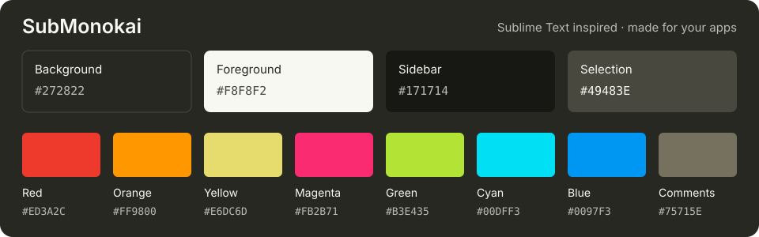

# SubMonokai

A dark colour theme inspired by Sublime Text's Monokai, adapted for terminals, writing, and task management. Warm charcoal backgrounds, off-white text, and bright accents carry the same palette across your apps.



## Themes

| Application | Theme file |
| --- | --- |
| [T3-Code](#t3-code) | [SubMonokai-T3-Code.json](SubMonokai-T3-Code.json) |
| [Ghostty](#ghostty) | [SubMonokai.ghostty](SubMonokai.ghostty) |
| [Rex](#rex) | [SubMonokai.ghostty](SubMonokai.ghostty) |
| [Terminal on macOS](#terminal-on-macos) | [SubMonokai.terminal](SubMonokai.terminal) |
| [iTerm2](#iterm2) | [Submonokai.itermcolors](Submonokai.itermcolors) |
| [Blink Shell](#blink-shell) | [SubMonokai-Blink.js](SubMonokai-Blink.js) |
| [Ulysses](#ulysses) | [SubMonokai.ultheme](SubMonokai.ultheme) |
| [TaskPaper](#taskpaper) | [Submonokai-Taskpaper.less](Submonokai-Taskpaper.less) |

Open the file for your app and use GitHub's **Download raw file** button to save it. You can also download the whole repository with **Code → Download ZIP**.

## Installation

### T3-Code

1. Download `SubMonokai-T3-Code.json`.
2. Open **Settings → Appearance** in T3-Code and import the JSON as a custom theme.
3. Select **SubMonokai** and choose dark appearance.

See the [T3-Code appearance guide](https://github.com/pingdotgg/t3code/blob/main/docs/user/appearance.md) for more theme settings.

### Ghostty

Clone this repository and install a symlink to the theme:

```sh
git clone https://github.com/scruffydan/submonokai.git ~/Code/submonokai
cd ~/Code/submonokai
sh ./install-ghostty.sh
```

The installer links `SubMonokai.ghostty` to `~/.config/ghostty/themes/SubMonokai`
(or `$XDG_CONFIG_HOME/ghostty/themes/SubMonokai` when set). It is safe to rerun
and refuses to overwrite an existing theme from another source. Keep the checkout
in place; pulling changes updates the linked theme.

Add this line to your Ghostty config, then reload the configuration:

```ini
theme = SubMonokai
```

Remove any inline colour overrides if you want the complete theme to apply.
Fonts, keybindings, and window settings stay in your own config.

For a standalone installation, download `SubMonokai.ghostty` and save it as
`~/.config/ghostty/themes/SubMonokai` instead.

[Ghostty theme guide](https://ghostty.org/docs/features/theme)

### Rex

1. Download `SubMonokai.ghostty`, or use the file from your checkout.
2. Open Rex's command palette and run **Import Theme File**.
3. Select `SubMonokai.ghostty` and apply the imported theme.

Re-import the file after changing its colours; the import is separate from
Ghostty's symlink installation.

### Terminal on macOS

1. Download `SubMonokai.terminal`.
2. Open **Terminal → Settings → Profiles**.
3. Choose **Import** from the action menu and select the file, or drag it into the profiles list.
4. Select the imported profile. Choose **Default** to use it for new windows.

[Terminal profile guide](https://support.apple.com/guide/terminal/import-and-export-terminal-profiles-trml4299c696/mac)

### iTerm2

1. Download `Submonokai.itermcolors`.
2. Open **Settings → Profiles**, select a profile, and go to **Colors**.
3. Choose **Color Presets → Import** and select the file.
4. Choose **Submonokai** from **Color Presets** to apply it to that profile.

[iTerm2 colour settings](https://iterm2.com/documentation-preferences-profiles-colors.html)

The iTerm2 export matches the Ghostty/Rex theme's 16 ANSI colours, background,
foreground, cursor, and selection colours. Bright white is `#EAEAEA`, matching
the default previously inherited by the Ghostty configuration.

### Blink Shell

1. Run `config` in Blink and open **Appearance**.
2. Choose **New Theme** and paste this raw theme URL:

   ```text
   https://raw.githubusercontent.com/scruffydan/submonokai/master/SubMonokai-Blink.js
   ```

3. Download and save the theme, then select it from the theme list.
4. Open a new tab or window to use the updated appearance.

[Blink customisation guide](https://docs.blink.sh/basics/customize)

### Ulysses

1. Download `SubMonokai.ultheme`.
2. On macOS, double-click the file in Finder to add it to Ulysses. On iPhone or iPad, open the downloaded file in Ulysses.
3. Select the theme in the editor's theme settings. On macOS, these are under **Ulysses → Settings → Markup**.

[Installing Ulysses themes](https://styles.ulysses.app/learn/overview)

### TaskPaper

1. Download `Submonokai-Taskpaper.less`.
2. In TaskPaper, choose **Window → StyleSheet → Open StyleSheet Folder**.
3. Copy the `.less` file into that folder and select it from **Window → StyleSheet**.
4. Use dark appearance to apply the stylesheet's dark colours.

The stylesheet uses **Source Code Pro**. Install it from the [fonts below](#fonts), or change `@font-family` in the stylesheet to your preferred font.

[TaskPaper stylesheet guide](https://guide.taskpaper.com/customizing-taskpaper/creating-stylesheets.html)

## Palette

The shared colours are listed in [SubMonokai Colors.md](SubMonokai%20Colors.md). The core background is `#272822`, text is `#F8F8F2`, and the sidebar is `#171714`.

Each app maps the palette to its own controls and theme format. The T3-Code version also includes `#B8BAB3` for muted text.

## Fonts

The repository includes two optional font families:

| Font | Files | Use |
| --- | --- | --- |
| Source Code Pro | [Fonts/SourceCodePro](Fonts/SourceCodePro) | Monospaced text; used by the TaskPaper stylesheet. |
| SauceCodePro Nerd Font | [Fonts/SauceCodePro](Fonts/SauceCodePro) | Source Code Pro with additional glyphs for terminal prompts and tools. Choose a **Mono** variant for fixed-width icons. |

On macOS, open the downloaded `.otf` or `.ttf` files in Font Book to install them, then select the family in your app's font settings. Fonts are configured separately from colours.

See the [SauceCodePro notes](Fonts/SauceCodePro/README.md), its [font licence](Fonts/SauceCodePro/LICENSE.txt), and [Adobe's Source Code Pro repository](https://github.com/adobe-fonts/source-code-pro) for upstream details.

## Contributing

New app ports and fixes are welcome. Use the [shared palette](SubMonokai%20Colors.md), name the theme for its target app when the format is ambiguous, and include installation steps in your pull request. For compatibility fixes, include the app version you tested.
